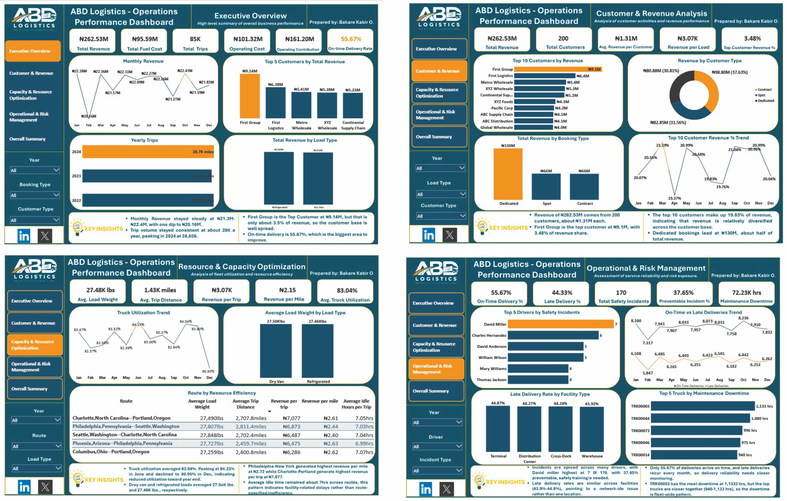

## ABOUT ME

Hello! I'm Bakare Kabir Olamide, a Data Analyst and Ichthyologist with a passion for transforming raw data into meaningful insights that support better business decisions.

## SKIllS
✅ Data Cleaning and Transformation.
✅ Exploratory Data Analysis (EDA).
✅ Data Analysis and Interpretation.
✅ Data Visualization and Storytelling.
✅ Business Insights and Data-Driven Decision-Making.
✅ Data Report and Presentation.

## 🛠️ TOOLS & TECHNOLOGIES
- **Power BI:** Interactive dashboards and business intelligence
- **DAX:** Measures, KPIs, and analytical calculations
- **Microsoft Excel:** Data analysis and reporting
- **Power Query:** Data cleaning and transformation
- **SQL:** Developing my skills in querying and analyzing data

## 📊FEATURED PROJECTS
*A glimpse of some of the projects i've been working on*

 **1 Logistics Performance Analysis**

 *Analyzed logistics business performance through revenue, operating costs, truck utilization, delivery performance, and operational risk.*
 
 

**Key focus areas:**
- Revenue and operating performance
- Customer and revenue analysis
- Resource and capacity optimization
- Operational performance and risk management
  

**2 Loan Portfolio Analysis**
*Analyzed a loan portfolio to understand lending activity, repayment performance, default risk, borrower behavior, and portfolio trends.*

**Key focus areas:**
- Portfolio performance
- Loan repayment and default analysis
- Borrower and product analysis
- Risk identification and business recommendations

## 🎯 My Goals
- Build practical data analytics projects using real-world business scenarios.
- Strengthen my skills in SQL, Power BI, Excel, and data storytelling.
- Turn complex datasets into clear, actionable business insights.
- Connect with professionals and opportunities in data analytics.

Let's Connect

I'm open to connecting with data analysts, learning from experienced professionals, and exploring opportunities to grow in the data analytics field.

LinkedIn: Add your LinkedIn profile URL here.

---

Thank you for visiting my portfolio!
