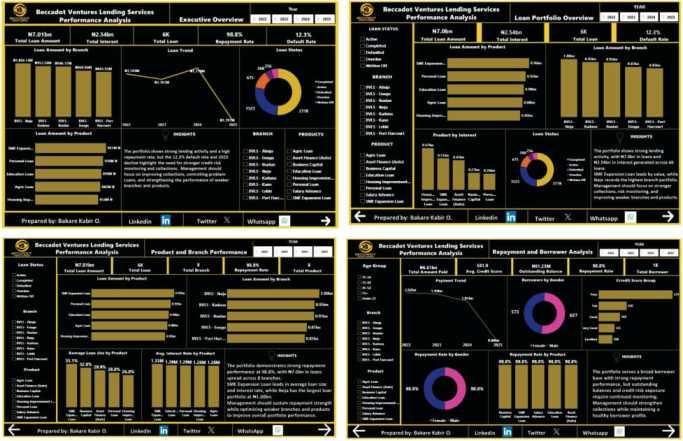
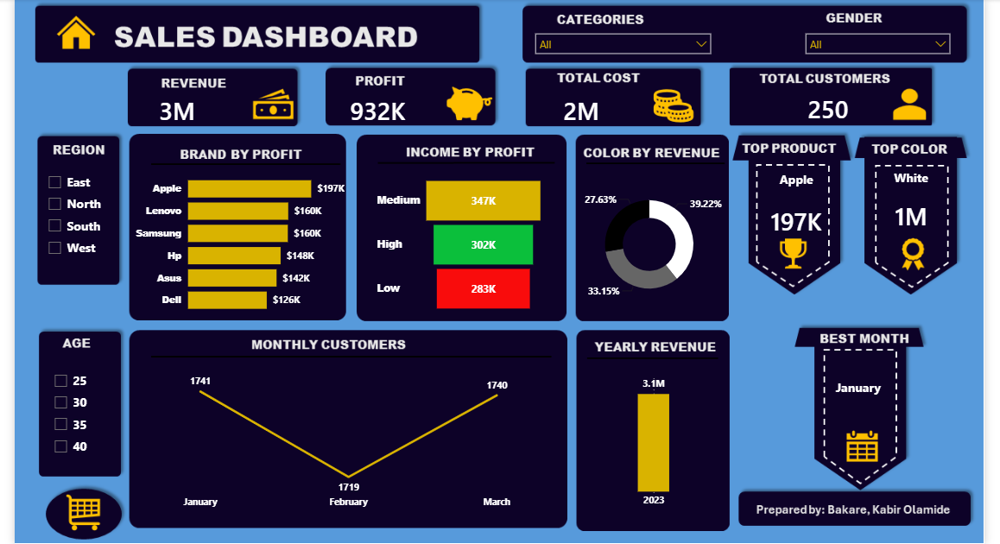

## ABOUT ME

Hello! I'm Bakare O. Kabir, an Ichthyologist and Data Analyst with a passion for transforming raw data into meaningful insights that support better business decisions.

## SKIllS
✅ Data Cleaning and Transformation.

✅ Exploratory Data Analysis (EDA).

✅ Data Analysis and Interpretation.

✅ Data Visualization and Storytelling.

✅ Business Insights and Data-Driven Decision-Making.

✅ Data Report and Presentation.

## 🛠️ TOOLS & TECHNOLOGIES
- **Power BI:** Interactive dashboards and business intelligence
- **DAX:** Measures, KPIs, and analytical calculations
- **Microsoft Excel:** Data analysis and reporting
- **Power Query:** Data cleaning and transformation
- **SQL:** Developing my skills in querying and analyzing data

## 📊FEATURED PROJECTS
*A glimpse of some of the projects i've been working on*

 **1 Logistics Performance Analysis**

 *Analyzed logistics business performance through revenue, operating costs, truck utilization, delivery performance, and operational risk.*
 
 

**Key focus areas:**
- Revenue and operating performance
- Customer and revenue analysis
- Resource and capacity optimization
- Operational performance and risk management

[Read More](https://lnkd.in/p/dYqEc_XF)
  

**2 Loan Portfolio Analysis**

*Analyzed a loan portfolio to understand lending activity, repayment performance, default risk, borrower behavior, and portfolio trends.*

**Key focus areas:**
- Portfolio performance
- Loan repayment and default analysis
- Borrower and product analysis
- Risk identification and business recommendations

[Read More]("C:\Users\dell\OneDrive\Desktop\Portfolio\PowerBi\Beccadot Lending Services\Beccadot Ventures Lending Services.pbix")

 
**3 Electronic Sales Performance Analysis**

 *Analyzed electronic sales performance to track revenue, profitability, costs and customer trends for data-driven business decisions.*
 
 

**Key focus areas:**
- Revenue Analysis
- Profit Optimization
- Product Performance
- Cost Tracking

 [Read More](https://lnkd.in/p/d56BgyfG)
 

## 🎯 My Goals
- Build practical data analytics projects using real-world business scenarios.
- Strengthen my skills in SQL, Power BI, Excel, and data storytelling.
- Turn complex datasets into clear, actionable business insights.
- Connect with professionals and opportunities in data analytics.

## CONTACT DETAILS
Let's connect and see how we can make a difference together!

---

📨    **bakardolamide05@gmail.com**

---

☎️    **+2347069123125**

---

📍     **Lagos,Nigeria**

---

🌐   [Connect with me on Linkedin]( https://www.linkedin.com/in/kabir-bakare-b81335377 )

---

Thank you for visiting my portfolio!
